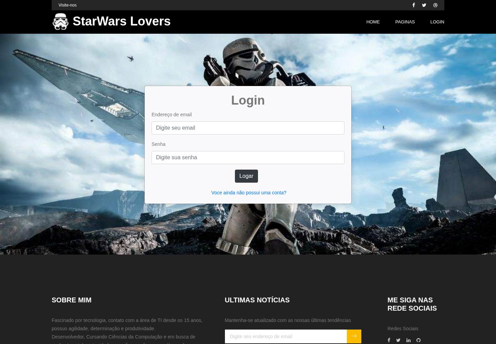

# Star Wars Lovers

Portal acadêmico para fãs de Star Wars, desenvolvido com React na disciplina de Tópicos de Programação Web. Apresenta páginas de filmes, pessoas, planetas, espécies e naves com consultas à SWAPI, além de telas demonstrativas de login, cadastro e perfil.

[](https://react.dev/)
[](LICENSE)

## 📋 Table of contents

- [✨ Features](#features)
- [🧪 Technologies](#technologies)
- [🛠️ Environment setup](#environment-setup)
- [🚀 Getting started](#getting-started)
- [🔌 API usage](#api)
- [🗂️ Project structure](#structure)
- [✅ Testing and quality](#testing)
- [🔎 Troubleshooting](#troubleshooting)
- [🤝 Contributing](#contributing)
- [📜 License](#license)

<a id="features"></a>

## ✨ Features

- Navegação com `HashRouter`, adequada ao roteamento por fragmentos em hospedagem estática.
- Listagem de filmes, pessoas, planetas, espécies e naves pela API externa.
- Indicador de carregamento e interface com React Bootstrap/template Woodrox.
- Páginas de login, cadastro e perfil demonstrativas. O login atual apenas registra os valores no console e não autentica usuários; use somente dados fictícios.

<a id="technologies"></a>

## 🧪 Technologies

Declarações de [package.json](package.json), sem lockfile:

| Tecnologia | Versão | Finalidade |
| --- | --- | --- |
| [React](https://react.dev/) / React DOM | `^16.9.0` | Interface |
| [Create React App](https://create-react-app.dev/docs/getting-started/) | `react-scripts 3.1.1` | Desenvolvimento, testes e build |
| [React Router](https://v5.reactrouter.com/) | `^5.0.1` | Rotas por hash |
| [Axios](https://axios-http.com/docs/intro) | `^0.19.0` | Consultas externas |
| [Bootstrap](https://getbootstrap.com/docs/4.3/getting-started/introduction/) | `^4.3.1` | Estilos |
| [React Bootstrap](https://react-bootstrap.github.io/) | `^1.0.0-beta.12` | Componentes |

`firebase.json` configura hospedagem estática de `build/`. O HTML em `public/index.html` também carrega Firebase App SDK 7.1.0 por CDN e contém uma inicialização legada, mas não carrega o SDK de Authentication nem implementa autenticação no formulário React. O mesmo HTML referencia Google Maps e outros recursos do template.

<a id="environment-setup"></a>

## 🛠️ Environment setup

Tenha Git e Node.js. O repositório não define `engines` ou arquivo de versão; foi escolhido Node.js 14.21.3 para tentar reproduzir a geração de `react-scripts@3.1.1`/Webpack 4 sem as mudanças de OpenSSL de runtimes posteriores. Trata-se de uma versão histórica, cuja atualização deve ser avaliada separadamente.

```bash
nvm install 14.21.3
nvm use 14.21.3
git clone https://github.com/paulodaluz/StarWarsApi.git
cd StarWarsApi
npm install
```

Não há lockfile para `npm ci`, hooks ou script `prepare`. Os scripts usam o `react-scripts` local. Não há `.env` de exemplo nem variáveis próprias necessárias para iniciar a interface.

As consultas são configuradas diretamente em [src/services/apiswGets.js](src/services/apiswGets.js), com base `https://swapi.co/api`. Essa é a URL legada do código, não uma afirmação de disponibilidade atual. A migração para outro serviço/endereço é uma alteração de código separada.

Confira também as configurações externas embutidas em `public/index.html` e `.firebaserc` antes de usar hospedagem ou integrações próprias. Não há leitura de variáveis de ambiente para esses identificadores; os valores existentes não devem ser reutilizados como credenciais de um novo projeto.

<a id="getting-started"></a>

## 🚀 Getting started

```bash
npm start
```

O Create React App utiliza `http://localhost:3000` por padrão. Por exemplo, a tela demonstrativa de login fica em `http://localhost:3000/#/login`. Para uma porta alternativa temporária no shell POSIX:

```bash
PORT=4403 BROWSER=none npm start
```

A porta 4403 é somente uma escolha de validação, não uma configuração do projeto. Encerre com `Ctrl+C`.

Para compilar os arquivos estáticos:

```bash
npm run build
```

O resultado fica em `build/`. Se Python 3 já estiver instalado, pode conferir esse resultado com `python3 -m http.server 8000 --bind 127.0.0.1 --directory build` e acessar `http://127.0.0.1:8000`. O arquivo `firebase.json` também aponta a hospedagem para `build/`, mas implantação e CLI Firebase não foram utilizadas nesta tarefa.

<a id="api"></a>

## 🔌 API usage

O repositório consome uma API; não fornece servidor próprio. `apiswGets.js` faz GET em `/people/`, `/films/`, `/planets/`, `/species/` e `/starships/`, relativos à URL legada `https://swapi.co/api`, e retorna `response.data.results`. Não há autenticação nessa integração nem carregamento de páginas seguintes implementado nesse serviço.

A interface pode abrir mesmo quando as consultas externas falham. A renderização de uma tela estática não valida os dados da SWAPI.

<a id="structure"></a>

## 🗂️ Project structure

| Caminho | Responsabilidade |
| --- | --- |
| `src/App.js` | Mapa das rotas |
| `src/pages/` | Páginas de conteúdo e formulários demonstrativos |
| `src/components/` | Cabeçalho, rodapé e loading |
| `src/services/apiswGets.js` | Consultas à SWAPI |
| `public/` | HTML e recursos estáticos do template |
| `public/woodrox-doc/` | Documentação e créditos do template |
| `firebase.json` | Configuração de hospedagem de `build/` |

<a id="testing"></a>

## ✅ Testing and quality

| Comando | Finalidade |
| --- | --- |
| `npm test -- --watchAll=false` | Executar Jest sem observação |
| `npm run build` | Compilar a aplicação |

Existe um teste de renderização em `src/App.test.js`. Não há script separado de lint; o build utiliza as verificações do Create React App. `npm run eject` é uma operação irreversível de configuração e não é necessária para executar o projeto.

Com Node.js 14.21.3/npm 6.14.18, a instalação e `npm run build` concluíram. `CI=true npm test -- --watchAll=false --runInBand` passou: uma suíte e um teste, com avisos de propriedades CSS React (`text-transform`/`font-family`). O servidor de desenvolvimento iniciou na porta temporária 4403 e a tela `/#/login` respondeu HTTP 200 no Chromium 156.0.8078.79. A captura real foi revisada sem preencher credenciais. O navegador registrou `firebase is not defined` no HTML legado, embora a tela React tenha sido exibida. Integração SWAPI e serviços externos não foram validados. O processo foi encerrado.

<a id="troubleshooting"></a>

## 🔎 Troubleshooting

| Situação | Verificação |
| --- | --- |
| Listas não carregam | Confira a URL legada da SWAPI e os erros de rede/CORS no navegador. A substituição do serviço não foi feita nesta entrega. |
| Erro de OpenSSL ao compilar | Confira o runtime histórico selecionado para Webpack 4; não altere dependências sem validação separada. |
| `firebase is not defined` no console | Confira o carregamento do SDK externo de Firebase referenciado em `public/index.html`; a inicialização legada não tem proteção contra falha de carregamento. |
| Login não cria sessão | A tela é demonstrativa e não tem autenticação implementada. |
| Rota não abre em hospedagem estática | Use os caminhos com `#`, como `/#/filmes`, de acordo com `HashRouter`. |

<a id="contributing"></a>

## 🤝 Contributing

Crie uma branch a partir de `master`, valide build, teste de renderização e telas afetadas e abra um pull request. Preserve os créditos e recursos de terceiros do template. Correções de integração e atualizações de dependências ficam em alterações separadas.

<a id="license"></a>

## 📜 License

O projeto está sob a [licença MIT](LICENSE), com copyright de 2021 de Paulo da Luz. Os recursos e a documentação do template Woodrox em `public/` foram preservados, incluindo seus créditos e condições próprias.

---

<p align="center">Made with 💜 by <a href="https://github.com/paulodaluz">Paulo da Luz</a></p>
